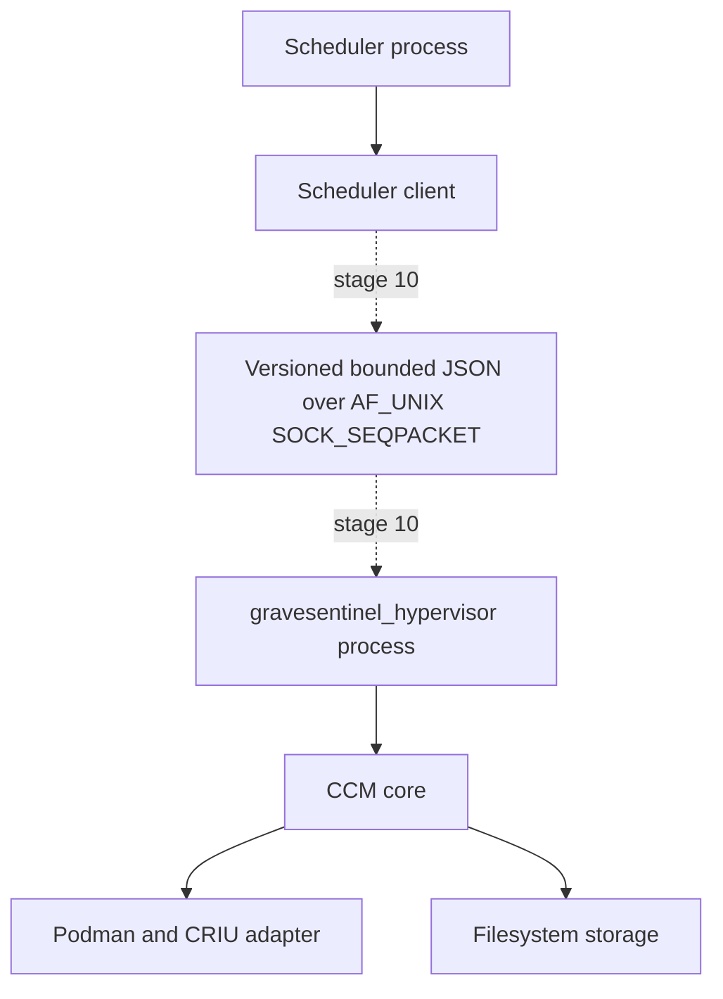

# Checkpoint Cache Manager: архитектура MVP

## Назначение этого документа

Документ фиксирует общие архитектурные контракты MVP и обновляется по мере
завершения этапов. Реальный runtime profile и Manifest v1 уже квалифицированы,
но production orchestration, файловое хранилище и IPC ещё не реализованы.
Бинарный target `//src/hypervisor:gravesentinel_hypervisor` собирается, но при
запуске явно завершается с ошибкой до появления сервера в этапе 10.

## Граница процессов

Scheduler и CCM не разделяют адресное пространство. Scheduler владеет desired
registrations и использует только библиотеку `//src/scheduler_client`. Отдельный
Linux-процесс `gravesentinel_hypervisor` будет владеть алгоритмическим core,
Podman/CRIU adapter, хранилищем, рабочими потоками, периодическими checkpoint,
retention и GC.



Только hypervisor вправе запускать runtime-команды. `IProcessRunner` принимает
исполняемый файл и массив аргументов; контракт не допускает shell-команду,
собранную конкатенацией строк. Scheduler не зависит от `ccm_core`, storage или
Podman adapter.

## Граф Bazel targets и visibility

```mermaid
flowchart TD
    SchedulerConsumer[Scheduler consumer]
    SchedulerClient[//src/scheduler_client:scheduler_client]
    Protocol[//src/protocol:protocol]
    Hypervisor[//src/hypervisor:gravesentinel_hypervisor]
    Core[//src/core:ccm_core]
    Hasher[//src/core:blake3_hasher]
    Manifest[//src/manifest:manifest]
    Crypto[//src/crypto:blake3]
    Blake3[@blake3//:blake3]
    Json[@nlohmann_json//:json]
    Unit[//tests/unit]

    SchedulerConsumer --> SchedulerClient
    SchedulerClient --> Protocol
    Hypervisor --> Core
    Core --> Protocol
    Hasher --> Core
    Hasher --> Crypto
    Manifest --> Protocol
    Manifest --> Crypto
    Manifest --> Json
    Crypto --> Protocol
    Crypto --> Blake3
    Unit --> SchedulerClient
    Unit --> Core
    Unit --> Hasher
    Unit --> Manifest
```

`//src/core:ccm_core` виден только package гипервизора и unit tests.
Scheduler-facing библиотека публична, но её единственная проектная зависимость —
`//src/protocol:protocol`. Общие типы protocol не содержат storage, runtime или
Linux API.

BLAKE3, nlohmann JSON и GoogleTest закреплены точными версиями в `MODULE.bazel`.
`//src/crypto:blake3` использует настоящий BLAKE3 C API, а
`//src/manifest:manifest` — pinned nlohmann JSON для strict canonical Manifest v1.
Эти зависимости остаются за внутренней hypervisor/core границей и не попадают в
scheduler-facing target.

## Типы и валидация

`ContainerId`, `CheckpointId`, `RequestId`, `OperationId` и
`RuntimeContainerRef` — разные strong types. Фабрика отклоняет пустые значения и
встроенный NUL. `ChunkHash` всегда содержит 32 байта BLAKE3 digest.

`CheckpointConfig` имеет defaults `interval = 60s`, `keep_last = 3`. Валидация
требует положительный interval, `keep_last` в диапазоне 1..3 и одну из пар
`(0,1)`, `(2,3)`, `(4,5)`, `(6,7)`. Набор регистраций дополнительно ограничен
четырьмя элементами и не может повторно назначать logical CPU.

`ColdStartSpec` отделён от изменчивого runtime container ID. Environment в нём
может содержать секреты: hypervisor не должен персистировать эти значения или
передавать их в диагностические логи.

`RuntimeFingerprint` содержит отдельные поля kernel, Podman/runtime build, CRIU,
OCI runtime/commit/features, cgroup, privilege/user namespace,
capability/SELinux/AppArmor/seccomp и command profile. Manifest v1 персистирует
их вместе с source image identity и отклоняет неполный fingerprint.

`RelativeSnapshotPath`, ordered artifacts/chunks, canonical JSON, parser limits и
BLAKE3 checksum определены в `docs/manifest-v1.md`. Лексический join пути не
заменяет будущий no-follow `openat2/openat` filesystem boundary.

## Внутренние контракты

`//src/core:ccm_core` объявляет:

- `ICheckpointService` — register/unregister, submit длительных create/restore и
  чтение `OperationStatus`;
- `IStorage` — атомарная публикация chunk/manifest и чтение опубликованных
  данных; требования fsync/rename и leases уточняются реализацией storage;
- `IPodmanAdapter` — capture, restore, cold start и cleanup неудачного restore;
- `IClock`, `IHasher`, `IIdGenerator` — детерминируемые зависимости core;
- `ILogger` — диагностическое логирование без секретных полей;
- `IAffinityController` — изоляция Linux affinity от алгоритмического core;
- `IProcessRunner` — argv-вызов процесса без shell;
- `CheckpointResult<T>` — `std::expected<T, CheckpointErrorDetail>` со стабильным
  кодом, retryability и optional correlation ID.

Подробный `diagnostic` остаётся внутри hypervisor. Будущий wire response содержит
только стабильный error code, request/correlation ID и однозначный status.

## Синхронный bool и асинхронная операция

Scheduler-facing `IHypervisorClient` сохраняет исходную семантику `bool`:
`true` означает подтверждённое завершение операции, `false` — любой конечный или
неопределённый неуспех. Он не должен возвращать `true` сразу после принятия
длительной операции.

На wire длительный вызов будет двухфазным:

1. submit с `RequestId` быстро возвращает accepted и стабильный `OperationId`;
2. `GetOperation` возвращает `queued`, `running`, `succeeded`, `failed` или
   `indeterminate`;
3. concrete SchedulerClient реализует bool wrapper как submit + bounded wait,
   сохраняя различие operation states во внутренних результатах и логах.

Разрыв соединения не отменяет уже принятую операцию. Повтор того же `RequestId`
с тем же payload должен вернуть прежнюю операцию; reuse с другим payload должен
быть отвергнут.

## Wire protocol и безопасность

Transport/server появятся только в этапе 10. Зафиксированный будущий контракт:

- локальный `AF_UNIX/SOCK_SEQPACKET`, socket path из конфигурации;
- version handshake и bounded JSON envelope;
- обязательные `protocol_version`, `request_id`, `method`, `payload` и response
  status;
- отказ на неизвестных version/method/fields и malformed payload до побочных
  эффектов;
- owner/group/mode socket и проверка `SO_PEERCRED`;
- повторная валидация всех ID, runtime references, путей и cold-start данных на
  стороне hypervisor.

Локальный IPC не считается доверенной границей.

## Lifecycle и reconnect

Scheduler остаётся владельцем desired registrations. После старта или reconnect
он выполняет version handshake и идемпотентно повторяет `Register` для желаемого
набора. Hypervisor восстанавливает только безопасные terminal operation records и
committed checkpoint; секретный environment cold start в journal не попадает.
Прерванные create/restore после рестарта классифицируются как `failed` или
`indeterminate`, но не как фиктивный успех.

`Unregister` в будущей реализации остановит новые периодические задачи,
согласует активную операцию и только затем освободит один из четырёх слотов.

## Сборка и проверки

Проект использует Bazel с Bzlmod и C++23:

```text
bazel build //...
bazel test //...
bazel test //scripts:clang_format_test
```

Профили доступны как `--config=debug`, `--config=release`, `--config=asan`,
`--config=ubsan` и `--config=tsan`. Sanitizer-профили запускаются отдельно друг от
друга. Строгие warning flags применяются только через project-local Starlark
macros и не навязываются внешним repositories.
