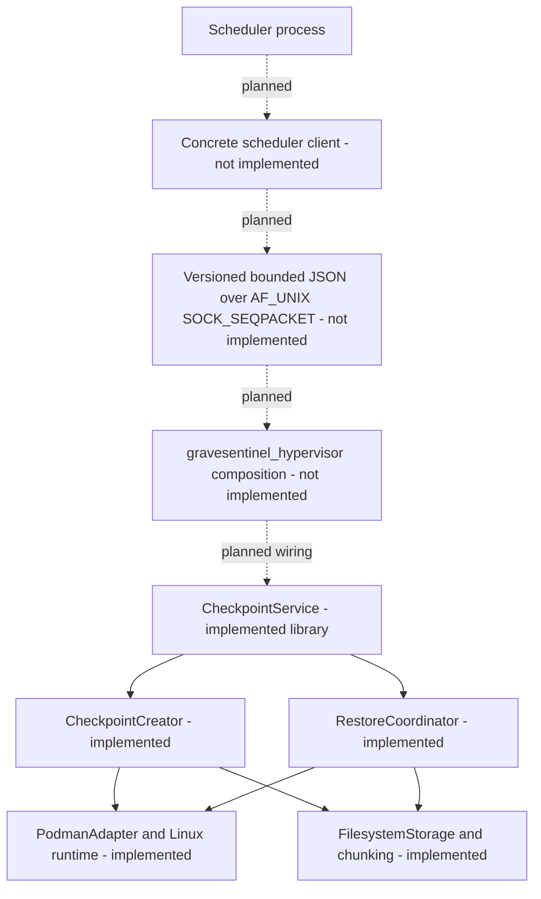
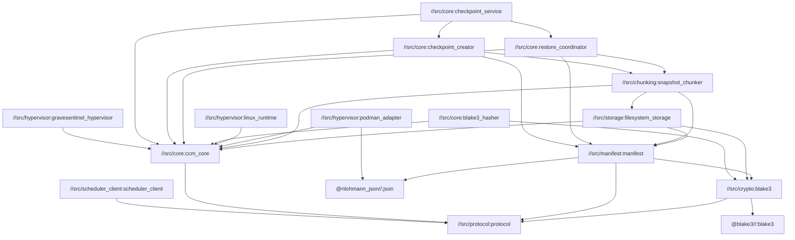
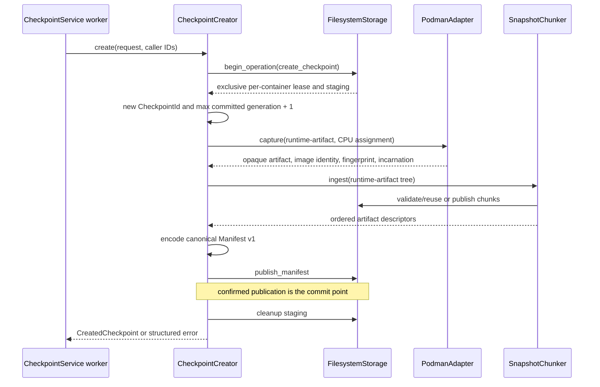
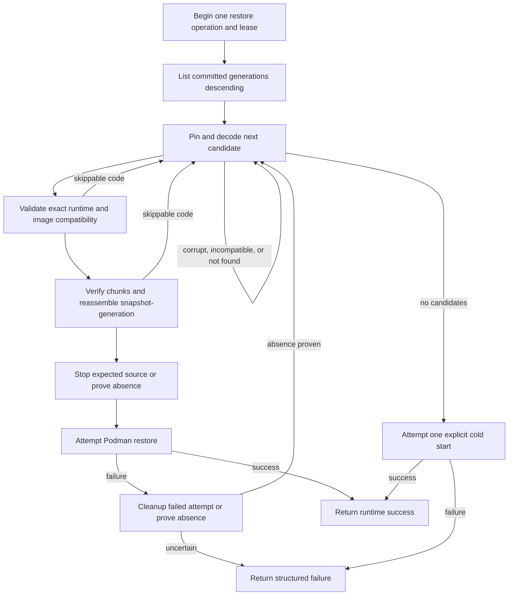

# Checkpoint Cache Manager: MVP Architecture

## Purpose and Current Status

This document describes the CCM components **actually present in the repository**,
their boundaries, and integration that has not yet been implemented. Normative details
of formats and algorithms are provided in the related documents listed in the
[documentation index](README.md).

The current code already includes:

| Area | Implementation | Status |
| --- | --- | --- |
| Common types and validation | `//src/protocol:protocol` | implemented, unit-tested |
| Manifest v1 and BLAKE3 | `//src/manifest:manifest`, `//src/crypto:blake3` | implemented, unit-tested |
| Crash-safe storage | `//src/storage:filesystem_storage` | implemented, unit-tested |
| Chunking/reassembly | `//src/chunking:snapshot_chunker` | implemented, unit-tested |
| Linux process/affinity boundary | `//src/hypervisor:linux_runtime` | implemented, unit-tested |
| Podman/CRIU adapter | `//src/hypervisor:podman_adapter` | implemented, unit-tested, includes an opt-in smoke test |
| Create orchestration | `//src/core:checkpoint_creator` | implemented, unit-tested |
| Restore/fallback/cold start | `//src/core:restore_coordinator` | implemented, unit-tested |
| Registration/scheduling service core | `//src/core:checkpoint_service` | implemented, unit-tested |
| Production composition | `//src/hypervisor:gravesentinel_hypervisor` | **not implemented**: the binary is a stub |
| Scheduler client implementation and IPC | interfaces/design only | **not implemented** |
| Async operation journal/recovery | protocol types/design only | **not implemented** |
| Retention and garbage collection | operation kinds are reserved | **not implemented** |

`gravesentinel_hypervisor` currently does not create storage, a chunker, an adapter, a
creator, a restore coordinator, or a service. Its `main()` prints a message about the
missing IPC server and returns `EXIT_FAILURE`. The project should therefore be treated
as a set of complete and tested library layers, but not as a complete daemon/service.

## Process Boundary: Current and Planned

The Scheduler and CCM must not share an address space. The Scheduler owns the desired
set of registrations and sees only `IHypervisorClient` from the public
`//src/scheduler_client:scheduler_client`. This target currently contains only an
abstract synchronous `bool` interface; no concrete client exists.

The planned process boundary is:



Only the hypervisor process should be permitted to run rootful Podman/CRIU.
`IProcessRunner` accepts an executable and a separate `argv`; the production
`PosixProcessRunner` uses `execve` rather than shell concatenation. Scheduler-facing
code does not depend on storage, Podman, CRIU, or Linux APIs.

## Actual Bazel Target Graph

It is important to distinguish the existence of a library target from its inclusion
in an executable. The actual direct dependencies of the main project targets are:



A key limitation of the current graph is that the binary depends only on `ccm_core`;
there are currently no edges from the binary to the service, runtime, storage, or
orchestration libraries.

`ccm_core` contains contracts and structured errors, but not workflow implementations.
The Scheduler client depends only on the protocol. BLAKE3 `1.8.2.bcr.1`, nlohmann JSON
`3.12.0.bcr.2`, and GoogleTest `1.18.0.bcr.1` are pinned in `MODULE.bazel` and do not
appear in the public scheduler-facing target. `//tests/unit:unit_tests` is an
aggregating test suite, not a library node in this dependency graph.

## Identities and Configuration

`ContainerId`, `CheckpointId`, `RequestId`, `OperationId`, and
`RuntimeContainerRef` are distinct strong types. Their underlying factory rejects only
an empty value and an embedded NUL. Stricter constraints are imposed at other layers:

- Manifest v1 and `FilesystemStorage` limit container/checkpoint/storage IDs to 256
  bytes;
- manifest metadata must be valid UTF-8 without control characters;
- the runtime adapter applies its own constraints to Podman names, image references,
  argv, and the environment.

As a result, an identifier may be created successfully at the protocol layer but later
be rejected at the manifest/storage boundary. Until unified ingress validation is
introduced, the caller is responsible for checking this.

`CheckpointConfig` has defaults of `interval = 60s` and `keep_last = 3`. Registration
validation requires:

- a positive interval;
- `keep_last` in the range `1..3`;
- one of the CPU pairs `(0,1)`, `(2,3)`, `(4,5)`, `(6,7)`;
- no more than four registrations, with no duplicate CPU assignments;
- a bounded and syntactically valid `ColdStartSpec`;
- non-empty fields in the registration-level `RuntimeFingerprint`, if specified.

Two fields currently do not affect the workflow after validation:

- `keep_last`, because retention is not implemented;
- `ContainerRegistration::runtime_fingerprint`, because create stores the fingerprint
  measured by the adapter, while restore uses the fingerprint from the manifest.

`ColdStartSpec` is separate from the mutable runtime ID. Command profile v1 prohibits
mounts and arbitrary runtime options. The production adapter passes the environment
through a transient mode-`0600` env-file rather than through Podman argv or the process
environment. Names and values are validated further; NUL, CR, and LF are prohibited.

## Internal Interfaces and Concrete Guarantees

`//src/core:ccm_core` declares:

- `ICheckpointService` — synchronous register/unregister/create/restore/shutdown;
- `IStorage` and `IStorageOperation` — namespace reads, operation leases,
  publication, pinning, and cleanup;
- `IPodmanAdapter` — compatibility, capture, absence, restore, cold start, and cleanup;
- `IClock`, `ITimer`, `IHasher`, `IIdGenerator` — injectable dependencies;
- `ILogger` — structured diagnostic sink;
- `IAffinityController` and `IThreadAffinityBinding` — CPU validation/binding;
- `IProcessRunner` — exact argv/environment, bounded output, and typed termination;
- `CheckpointResult<T>` — `std::expected<T, CheckpointErrorDetail>`.

The shape of an interface does not prove all operational properties. For example, an
arbitrary `IStorage` implementation is not necessarily crash-safe or cross-process,
and an arbitrary collaborator may return diagnostics containing sensitive data. The
following properties apply to the production classes:

| Property | Implementing boundary |
| --- | --- |
| Cross-process per-container `flock` | `FilesystemStorage` |
| Temp + file `fsync` + no-replace publish + directory `fsync` | `FilesystemStorage` |
| Descriptor-relative no-follow reads | `FilesystemStorage`, chunker/reassembler |
| Mount-ID containment for the snapshot tree | `SnapshotChunker`/`SnapshotReassembler`, not storage as a whole |
| BLAKE3 verification of chunk contents | chunker/reassembler, not the raw storage API |
| Exact Podman/CRIU profile and ownership checks | `PodmanAdapter` |
| Shell-free child execution and process-group timeout | `PosixProcessRunner` |
| Same-container serialization within one service | `CheckpointService` |

All injected implementations must follow the calling layer's thread-safety and
sanitization rules. Core passes collaborator diagnostics to the logger without
universal secret redaction.

## Create Data Flow

A direct `CheckpointCreator::create` call returns a rich `CreatedCheckpoint`; the
service wraps it in `CheckpointResult<void>` and stores only the runtime incarnation
for the next restore.



The manifest is published last. Before that, published chunks are orphan candidates
and do not constitute a committed checkpoint. A directory-`fsync` failure after the
manifest rename produces `publication_may_be_visible`: the operation returns failure,
but the manifest may already appear in the next listing and occupy the generation.

Core does not maintain a journal/idempotency table. Unique `RequestId` and
`OperationId` values for a new attempt are the caller's responsibility. Production
storage rejects only a conflict with retained staging for the same operation key; a
retry after successful cleanup is not an idempotent replay.

Full details: [checkpoint-create.md](checkpoint-create.md).

## Restore Data Flow

A direct `RestoreCoordinator` call returns a `RestoredContainer` with an outcome,
incarnation, checkpoint metadata, and cleanup flags. Externally,
`ICheckpointService` returns only success/error and uses the incarnation as an internal
fence.



The fallback decision currently depends on the stable error code: `not_found`,
`corrupted_snapshot`, and `incompatible_runtime` are skippable regardless of which
collaborator produced them. Collaborators must therefore not mask a control-plane
failure with one of these codes.

The first suitable candidate is fully reassembled before the known source incarnation
is stopped. After a failed restore and confirmed cleanup, older candidates are checked
during downtime. This is important when estimating worst-case recovery latency.

Full details: [checkpoint-restore.md](checkpoint-restore.md).

## Service Core: Concurrency and Scheduling

`CheckpointService` supports at most four registration slots. Each slot has a separate
persistent worker pinned to `checkpoint_cpu` and a mailbox with capacity one. The
control caller thread is not rebound.

Guarantees within a single service instance:

- create and restore for the same `ContainerId` are serialized;
- operations in different slots may run concurrently;
- a second synchronous caller waits for the slot to become available;
- a periodic tick is skipped if the slot is busy, with no catch-up burst;
- unregister closes the slot to new work and waits for accepted/active manual work;
- shutdown closes all slots, stops the scheduler, and joins the workers;
- a worker catches exceptions from the operation implementation and remains available.

Limitations:

- FIFO/fairness among multiple manual callers and the scheduler is not guaranteed;
- operation cancellation and service-level deadlines are not implemented;
- a hung collaborator may delay the caller, unregister, and shutdown indefinitely;
- a periodic result is available only through `ILogger`;
- a periodic `RequestId` is constructed as `periodic-<container>-<slot-sequence>` and
  may repeat after unregister/re-register; `OperationId` is generated separately;
- an exception in the scheduler loop is logged and terminates periodic scheduling
  without a health API;
- affinity restoration may fail, and that error is returned by explicit
  unregister/shutdown; the destructor cannot report it to the caller.

Details: [service-core.md](service-core.md).

## Persistence Boundary

A committed checkpoint is defined by the presence of a canonical manifest, not staging
or a chunk. The main layout is:

```text
root/
  containers/<container-key>/
    identity
    manifests/<20-digit-generation>.json
    chunks/<two-hex-prefix>/<64-hex-blake3>
    staging/<operation-key>/...
  locks/<container-key>.lock
  tmp/
```

Raw IDs do not become path components: storage uses domain-separated BLAKE3 keys and
checks the immutable `identity`. The operation lease is held until the operation state
is destroyed; a longer-lived pin may extend the lease. Manifest/chunk publication is
immutable and no-replace.

`FilesystemStorage` trusts a pre-created absolute root and an administrator who does
not change the namespace under the running process. It applies descriptor-relative
and no-follow checks, but mount-ID containment for snapshot trees is provided only by
chunking/reassembly. NFS/FUSE/overlay and filesystems without reliable directory
`fsync` have not been qualified.

Details: [filesystem-storage.md](filesystem-storage.md),
[chunking.md](chunking.md), [manifest-v1.md](manifest-v1.md).

## Runtime Boundary

`PodmanAdapter` implements only `podman-criu-rootful-v1`. It checks the exact
fingerprint, immutable image ID, ownership labels, cpuset, and immutable 64-hex runtime
ID. `ContainerId`, stable `RuntimeContainerRef`, and single-lifetime
`RuntimeIncarnation` are not interchangeable.

The main safety rules are:

- capture uses an opaque `checkpoint.tar` and `--leave-running`;
- the source image must remain available in the local Podman image store for restore;
- stop/remove is permitted only for the expected incarnation;
- `confirm_absence` performs both regular and external read-only existence probes;
- destructive failed-restore cleanup is permitted only after its own attempt, which
  began when absence had been proven under a continuous per-container lease;
- an unknown fingerprint or image mismatch fails closed;
- runtime stderr is not included in production adapter diagnostics.

Qualification is tied to a specific rootful host profile and makes no general claims
about other kernels, versions, architectures, or security policies. See
[testbed.md](testbed.md) and
[ADR 0001](adr/0001-podman-criu-runtime-profile.md).

## Errors and Indeterminate Side Effects

`CheckpointErrorDetail` contains:

- a stable `StableErrorCode`;
- an internal diagnostic;
- `retryable`;
- an optional correlation `RequestId`;
- `StorageSideEffect`;
- `RuntimeSideEffect`.

The two side-effect flags cannot be inferred from the error code alone:

- `publication_may_be_visible` means that an immutable publication may have become
  visible even though durability was not confirmed;
- `incarnation_may_exist` means that a runtime incarnation may have been created or
  its absence was not proven.

After such a result, a destructive action must not be retried automatically without
reconciliation/absence proof. The service conservatively adds these flags to
exceptions because the exception may have occurred after an opaque side effect.

Diagnostics are currently internal. The future wire boundary should return a stable
code/status/correlation, but not arbitrary internal diagnostics.

## Future Async IPC Contract

The following section is a design, not an implemented API.

The scheduler-facing `IHypervisorClient` retains synchronous `bool` semantics:
`true` must mean confirmed completion, not merely acceptance of a long-running
operation. The planned wire flow is:

1. submit with a unique `RequestId` returns accepted and an `OperationId`;
2. `GetOperation` returns `queued`, `running`, `succeeded`, `failed`, or
   `indeterminate`;
3. the concrete scheduler client implements a bounded wait over submit/poll;
4. a disconnect does not cancel an accepted operation;
5. repeating the same request/payload returns the previous operation, while reusing an
   ID with a different payload is rejected.

Neither a journal, deduplication, nor `GetOperation` is currently implemented. The
current synchronous service core does not itself provide the described idempotency.

The planned transport is:

- local `AF_UNIX/SOCK_SEQPACKET`;
- a version handshake and bounded JSON envelope;
- an exact schema that rejects unknown fields/methods/versions;
- socket owner/group/mode and `SO_PEERCRED`;
- repeated server-side validation of all IDs and cold-start data.

Local IPC must not be treated as a trusted boundary.

## Lifecycle and Features Not Yet Implemented

The following are still required for an operational MVP:

1. a composition root for storage, hashing, runtime, create/restore, and the service;
2. configuration of the storage root, Podman/CRIU paths, socket, and logging;
3. a Unix socket server and concrete scheduler client;
4. a bounded async operation registry/journal and reconnect semantics;
5. startup reconciliation for indeterminate publications and stale staging;
6. retention according to `keep_last`, with pin-aware deletion;
7. garbage collection of orphan chunks/temp/staging;
8. an end-to-end test of the complete daemon flow.

Until these layers exist, the Scheduler cannot perform registration or checkpointing
through `gravesentinel_hypervisor`, and `keep_last` does not limit the number of
manifests.

## Build and Checks

The project uses Bazel `8.8.2`, Bzlmod, and C++23. Project-local Starlark macros enable
strict warnings and `-Werror` without imposing them on external repositories.

The primary check is:

```text
bazel test //:checks
```

It includes the clang-format test and `//tests/unit:unit_tests`. Broader commands are:

```text
bazel build //...
bazel test //...
bazel test //scripts:clang_format_test
```

Unlike `//:checks`, the wildcard test also finds non-manual tests outside the unit
suite, such as the integration fixture's unit test.

Manual integration targets are excluded from `bazel test //...`. They should be run
only in a qualified rootful environment according to the instructions in
[testbed.md](testbed.md). `bazel build //:hypervisor` successfully builds the current
stub, but running it intentionally returns failure.

Independent profiles `--config=debug`, `--config=release`, `--config=asan`,
`--config=ubsan`, and `--config=tsan` are available.
